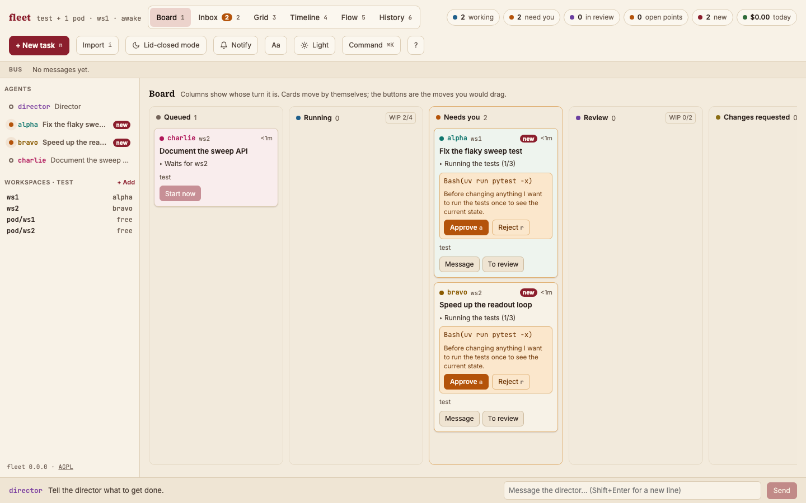
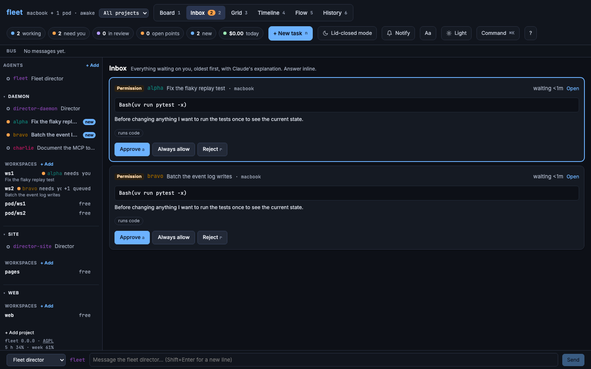
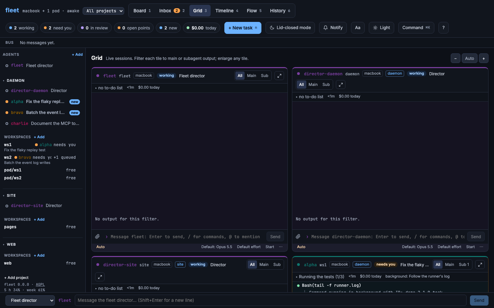
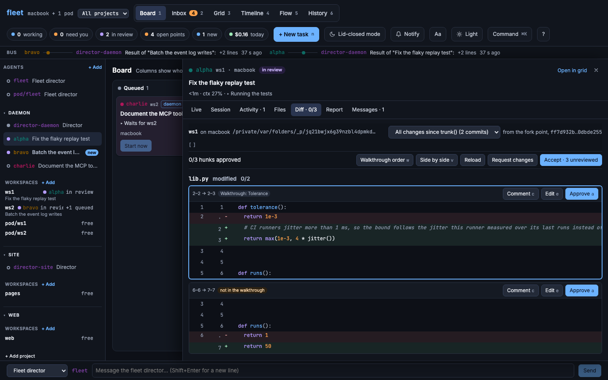
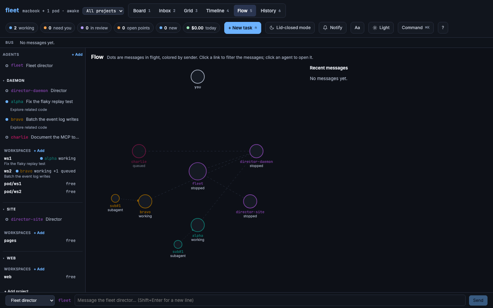
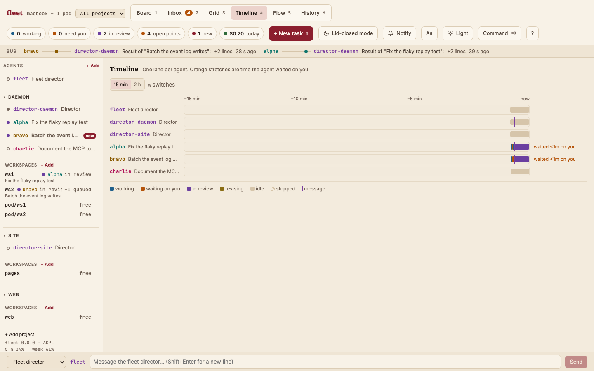
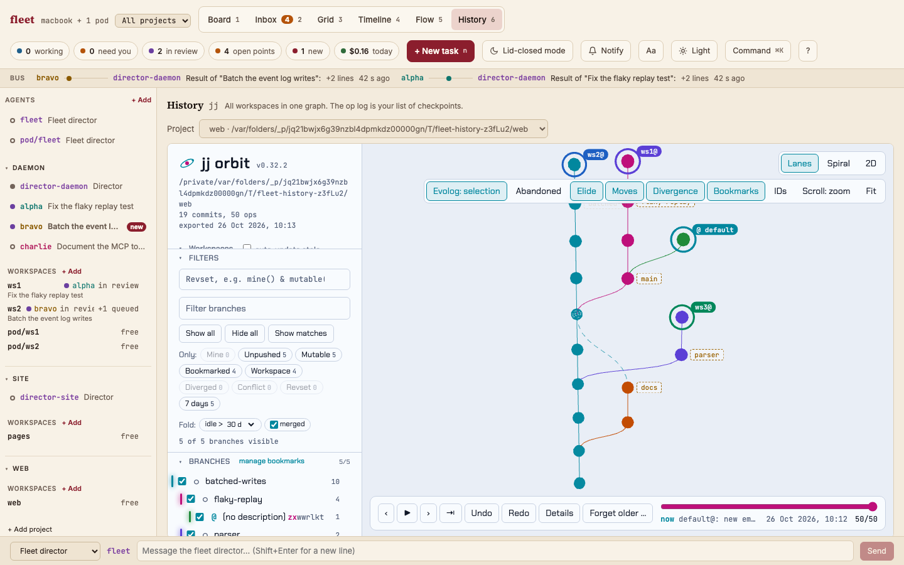

# fleet

fleet is a daemon and a web UI for running several Claude Code agents in parallel. A director agent takes the
work from you, splits it into tasks and hands each one to a worker agent in its own jj workspace. You watch them
all in one browser tab and answer what they ask. The homepage is
[lienemann.github.io/fleet](https://lienemann.github.io/fleet/). The design is in [docs/design.md](docs/design.md),
and [docs/mockup/](docs/mockup/) has the clickable mockup it was built from.



## What it does

The daemon runs one Agent SDK session per agent and writes everything that happens to a SQLite event log. The
browser rebuilds its state from that log, so closing the tab, losing Wi-Fi or restarting the daemon costs no agent
work: sessions resume where they were, and a crashed session reconnects with backoff.

There are six views, numbered as in the design. The board shows whose turn it is, with one column per task state.
The inbox collects what waits on you: permission prompts and questions with the text Claude wrote just before
asking, risk tags (network, writes outside the workspace, runs code), review requests, and Markdown files of open
points that you answer point by point. The grid shows the agents live, the way the CLI would, with the transcript,
subagents, to-do list, permission mode, model, context usage and a prompt that knows slash commands and `@` file
mentions. You can paste, drop or attach files there: images and PDFs go to Claude as they are, anything else is
saved into the agent's `.fleet` folder and mentioned by path. Assistant text and messages render as Markdown, with
tables and highlighted code. The timeline shows how long each agent waited on you, the flow view shows who sends
messages to whom, and the history view embeds jj orbit with the op log as checkpoints.

| | |
| --- | --- |
|  |  |
|  |  |
|  |  |

The screenshots come from the demo; `just screenshots` takes them again, for this README and the homepage.

Selecting an agent opens its drawer. Besides the diff, report and messages, the Session tab shows where the agent
runs, what fills its context window (split up the way `/context` does it) and which files it wrote. The Activity
tab lists its tool calls with their input and output, its subagents with their steps, and its background tasks.

When a session's context fills up, Hand over (Shift+H) asks it to write a handover document to
`.fleet/<agent>/handover-N.md`. fleet then starts a fresh session under the same name, which reads the document and
carries on, and tells the director. Each agent has a color and, if you like, a background tint of that color; both
are set from the dot in the tile header.

Agents talk to fleet through tools the daemon serves in-process. A worker calls `report_result` when it is done,
`request_decision` or `request_review` when it needs you, `submit_open_points` for a file of questions,
`report_status` for the line on its card and `send_message` to reach the director or you. The director has
`spawn_task`, which starts a worker with a written brief, plus `ledger`, `update_task`, `remove_task` and
`stop_task`; it cannot edit code. It can rename any task, but rewrite the brief or change the workspace only while
the task is queued. Removing a task whose workspace holds work needs your yes in the inbox.

Review happens in a diff view built on reviewdiff-core. You approve hunk by hunk, and approvals go into
ReviewDiff's own `approvals.json`, so when the agent revises its change only the hunks it touched come back. The
diff follows the order of the agent's walkthrough and marks the hunks the walkthrough leaves out. Its header names
the workspace and the revisions compared, and lets you review the whole change since trunk or one commit of the
workspace's stack at a time. You can comment
on lines, fix a typo yourself (the edit lands in the commit that wrote the line), and then accept the task or send
the comments back as one message.

Daemons on Coder pods show up in the same UI through the daemon on the Mac. On the Mac, fleet keeps the machine
awake while agents work, can keep it running with the lid closed, and sends desktop notifications when an agent
needs you while fleet is in the background. Everything is reachable from the keyboard, and the UI installs as an
app.

Not there yet: rewind (op restore plus a session fork), showing which review comments a revision addressed,
op-log entries attributed to agents and agent colors in jj orbit, the CLI's "You should know" side agent, `/btw`,
and read-only lists of skills, hooks and MCP servers.

## Running it

fleet needs Node 24, jj, Python 3 for the history view, and a logged-in Claude Code on the same machine.

In the fleet checkout, `just install` builds the web UI and links the `fleet` command into `~/.local/bin`. Then, in
the jj repo you want to work on:

```
fleet init        # creates the jj workspaces ws1 to ws4 next to the repo and writes ~/.fleet/config.toml
fleet             # starts the daemon and prints the link that logs your browser in
```

`fleet init -n 2` makes two workspaces instead of four, and `--into DIR` puts them somewhere else. fleet keeps its
config and event log in `~/.fleet/`, or wherever `FLEET_HOME` points; without a config, the current directory is the
only workspace.

In the browser, `n` starts a new task: give it a title and a brief, pick a workspace, and a worker starts on it
there. Or tell the director what you want in the box at the bottom, and it splits the work into tasks itself. `i`
imports a session you started in the CLI: pick the workspace (`default` is the repo itself), pick the session, and
it becomes a task with its transcript. It starts detached, because the CLI may still have it open; close it there,
then send it a message and it continues in fleet. The Import button in the header does the same.

Any agent takes a message from the prompt at the bottom of its tile (`p` focuses the selected one). To work in a
jj workspace that exists already, press "+ Add" next to the workspace list: fleet lists the repo's workspaces it
does not use yet, and the one you pick is saved to the config. The same dialog takes any other directory, such as
another project: once it is added, `i` imports the Claude Code sessions recorded there. Tasks go into such a
directory only when they name it, so the director never puts work for this repo there.

To update fleet without losing sessions, pull and rebuild, then run `fleet restart` or pick "Restart fleet" in the command palette.
The daemon waits until no agent is in the middle of a turn, exits, and the `fleet` command starts the new version,
which resumes every session. Open pages reload themselves once they see the new build.

For working on fleet itself:

```
just demo         # build and start with scripted agents instead of Claude, to try the UI
just test lint    # unit and integration tests (need jj), then lint and typecheck
just e2e          # end-to-end tests in Chromium, Firefox and WebKit against demo daemons
```

For work on the UI, run `npm run dev:demo` (or `dev:daemon`) and `npm run dev:web` side by side.

The header and `fleet --version` show the version from `package.json`. To release, bump it, tag the commit
`v<version>` and push the tag: CI runs the checks and publishes a GitHub release with the built UI.

```toml
port = 7777
# auth = false                          # no login, for a computer nobody else uses
model = "opus"                          # default model, optional
wip = { running = 4, review = 2 }
disk = { min_free_gb = 10 }             # warn below this much free space (the default)
allowed_tools = ["Read", "Glob", "Grep", "Bash(jj:*)", "Bash(just:*)"]  # run without asking (the default)

[director]
path = "~/Projects/foo"                 # the default workspace, which you share; enabled = false turns it off

[[workspaces]]
name = "ws1"
path = "~/Projects/foo/workspaces/ws1"  # a jj workspace of the same repo
# allowed_tools = [...] replaces the list for this workspace
# explicit = true: only tasks that name it go there (set for directories added from elsewhere)

[[remotes]]                             # a daemon on a Coder pod, through a tunnel to its port
name = "pod1"
url = "http://127.0.0.1:7801"

[history]
# repo = "~/Projects/foo"               # the director's workspace unless set
# python = "python3"
```

On a pod, run the same daemon with its own workspaces and `[director] enabled = false`, then forward its port with
`coder port-forward <pod> --tcp 7801:7777` or `ssh -L 7801:127.0.0.1:7777 <pod>`.

## Claude Code sessions outside fleet

The daemon serves an MCP server at `/mcp`, so a Claude Code session you run yourself can work alongside the fleet:

```
claude mcp add --transport http fleet http://127.0.0.1:7777/mcp --header "Authorization: Bearer $(cat ~/.fleet/secret)"
```

Such a session can then list the workspaces with whoever holds them, claim a free one to work in and release it
afterwards, list fleet's tasks, hand a new task to fleet, change or remove tasks as the director can, and send a
message to an agent, the director or you. No task starts in a claimed workspace, and the director's tasks go
elsewhere. The rail shows the claim with a release link, for a session that forgot to give it back.

With two hooks in `~/.claude/settings.json`, sessions claim and release workspaces by themselves:

```json
{
  "hooks": {
    "SessionStart": [{ "hooks": [{ "type": "command", "command": "[ -n \"$FLEET_AGENT\" ] || curl -sf --max-time 2 -H 'Content-Type: application/json' -H \"Authorization: Bearer $(cat ~/.fleet/secret 2>/dev/null)\" --data-binary @- http://127.0.0.1:7777/hooks/claude || true" }] }],
    "SessionEnd": [{ "hooks": [{ "type": "command", "command": "[ -n \"$FLEET_AGENT\" ] || curl -sf --max-time 2 -H 'Content-Type: application/json' -H \"Authorization: Bearer $(cat ~/.fleet/secret 2>/dev/null)\" --data-binary @- http://127.0.0.1:7777/hooks/claude || true" }] }]
  }
}
```

A session that starts inside a free workspace then holds it, and one that starts where a task works is told so.
A session that starts in the repo itself learns a name such as `session-ab12cd34` to claim workspaces under. When
the session ends, everything it claimed stays reserved for ten minutes: a session that starts in such a workspace
in that time takes it over (after `/clear` or a handover), a resumed session keeps it, and otherwise fleet releases
it. fleet's own sessions set `FLEET_AGENT` and skip the hooks.

## Security

The daemon can make agents run commands, so it listens on 127.0.0.1 only. It accepts browser connections only from
pages it served itself under a loopback host name, which also stops DNS rebinding. Reach it from elsewhere through
a tunnel, and add the tunnel's host name to `allowed_hosts` if it is not `localhost`.

Everyone on the same computer shares its loopback port, so the daemon also asks for a secret. It makes one on first
start in `~/.fleet/secret`, readable only by you, and prints a link that logs your browser in; `fleet login` prints
it again, and the login page also takes the secret pasted in. The browser then keeps a cookie for a year. The hooks
and the MCP command above send the secret as a bearer token. For a daemon on a pod, copy the pod's secret to
`~/.fleet/remotes/<name>.secret` on the Mac, for example with `ssh pod cat .fleet/secret > ~/.fleet/remotes/pod1.secret`.
On a computer nobody else uses, `auth = false` in `config.toml` turns the login off. The daemon validates every
message from the browser, reads files only inside an agent's workspace, and lets the director write only to
`.fleet/director/`.

## Keeping the Mac running with the lid closed

Shift+L or the header button keeps the Mac awake with the lid shut until every agent is idle, for two hours at most,
and only while the battery is above 20 %. It needs one sudoers rule, added with `sudo visudo -f /etc/sudoers.d/fleet`:

```
janl ALL=(root) NOPASSWD: /usr/bin/pmset disablesleep 1, /usr/bin/pmset disablesleep 0
```

## Notifications and the app

Shift+N or the Notify button turns on desktop notifications; the browser asks for permission the first time.
fleet notifies only while its window is in the background, once per agent, and a click opens that agent.

Every daemon checks the free space on the volumes that hold its workspaces and its event log once a minute. When a
volume has less than `min_free_gb` left, a banner names it and what fleet keeps there, with the pod's name for a
remote daemon, and a notification goes out. The banner stays until the volume has a fifth more than that again.

To install fleet as an app, open the daemon's address in Chrome or Edge and choose Install in the address bar, or
use File > Add to Dock in Safari. Browsers install only from a secure context; `localhost` and `127.0.0.1` count as
one, also through a tunnel.

## Keyboard

Press `?` for every shortcut, or Cmd+K (Ctrl+K elsewhere) to run any command by name. The keys are mnemonics:

| Keys | Action |
| --- | --- |
| `g b`, `g i`, `g g`, `g t`, `g f`, `g h` (or `1` to `6`) | go to board, inbox, grid, timeline, flow, history |
| `g d` | select the director |
| `j`, `k`, then `o` or Enter | next or previous agent (in the inbox: decision), open it in the grid |
| `n`, `i`, `d` | new task, import a CLI session, message the director |
| `p` | write to the selected agent; Esc leaves the field |
| `a`, Shift+A, `r` | approve, always allow, or reject its permission request |
| `m r`, `m c`, `m a`, `m o` | move to review, request changes, accept, reopen |
| `s`, Shift+M, Esc | stop or start the session (a queued task starts now if its workspace is free), next permission mode, interrupt |
| `t`, Shift+T, `x` | next or previous drawer tab, close the drawer (in the grid: back to all tiles) |
| `u`, Shift+L, Shift+N | mark all seen, lid-closed mode, notifications |
| Shift+H, Shift+F | hand the selected agent over to a fresh session, next font (sans, serif, mono) |
| `j`, `k`, `a`, `c`, `e`, `v`, `w`, Shift+R in the diff | next or previous hunk, approve and go on, comment, edit, side by side, walkthrough or file order, reload |
| `[`, `]` in the diff | review the next newer or older commit; above the newest is the whole change |
| `w` in the timeline | switch between the last 15 minutes and 2 hours |

## Vendored code

`vendor/reviewdiff` holds ReviewDiff's `src/core` and `src/vcs` (hunks, approvals, moves, the jj and git adapters),
packaged as the npm package `@zhinst/reviewdiff-core` would be. `vendor/jj-orbit` holds jj orbit's server and
viewer. Both are copies of upstream that a test keeps byte for byte; the README in each folder says how to update
them.

## License

fleet is copyright Jan Lienemann and free software under the GNU Affero General Public License, version 3 or
later ([LICENSE](LICENSE)). You may use, change and pass on fleet, also at work. If you pass on a changed version,
or let others use one over a network, its source has to be available under the same license. [NOTICE](NOTICE) adds
one term the license allows: the attribution "fleet by Jan Lienemann" stays in the notices the program shows.
ReviewDiff's code in `vendor/reviewdiff` keeps its MIT license.
